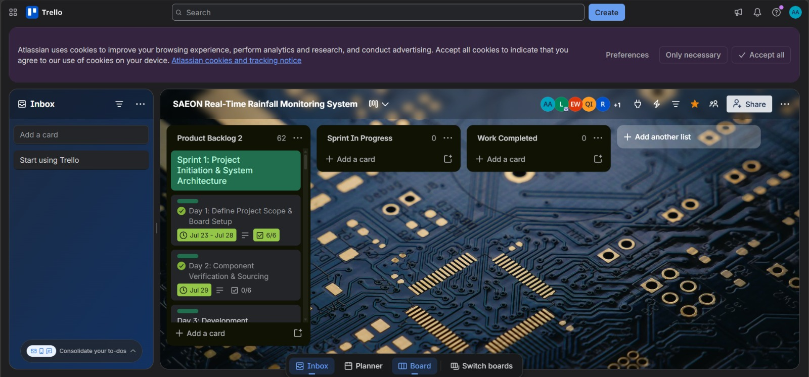

# Angelo Adams

| 📞 Phone | +27 68 098 7805        |

| 📧 Email | 230450431@mycput.ac.za |

---

## 🎯 Objective
Third-year Diploma in IT Applications student with strong foundation in software development, web technologies, and problem-solving. I am passionate about building innovative, user-centered solutions and continuously expanding my technical skillset.  

---

## 🎓 Education
* Diploma in Application Development | CPUT | 2024 – Present
* Higher Certificate in IT | CPUT | 2023
* Matric | Sibelius High School | 2022  

---

## 💻 Technical Skills
* Java
* Python
* HTML
* CSS
* MySQL
* GitHub
* Figma  

---

## 📂 Projects
### Peer-to-Peer Tutoring Web Application
- Built using JavaFX  
- Designed UI using Figma  
- Features:
  - User registration  
  - Session scheduling  
  - Data management
 
---

## 💼 Experience
### Sales Representative | Tekkie Town | 2024 – 2025
* Assisted customers with product/system issues
* Maintained digital sales records  

### Event Planner & Digital Media Contributor | 2023 – Present
* Organized events
* Managed digital content  

### Chess Facilitator
* Developed strategic thinking skills in learners

---

## 📞 References
- Enrico Hartman – Sibelius High – 082 381 9776  
- Helene Visagie – BottomUp – 084 702 4733

--- 

## 🎥 Mock Interview

<video width="600" controls>
  <source src="Interview.mp4" type="video/mp4">
  Your browser does not support the video tag.
</video>

---

# Reflection

### Markdown
Learning Markdown was a little challenging as I had never used Markdown syntax on GitHub before so getting into it was not as easy to pick up at the beginning. I was used to working in Word or other text editors so seeing the symbols such as #, *, and backticks was a little confusing. I needed to learn how to use Markdown correctly so I could present my work CV properly on GitHub and meet the project requirements. 

I started by looking up basic Markdown guides and examples online. I practiced things like headings, bullet points, code blocks, and links in a README file. I kept making small mistakes like forgetting spaces or using the wrong symbols, so I had to review my work more often and fix errors as I went along. I used trial and error and compared my work with other repositories to understand gain a better understanding on how everything should look.
At the end I was able to format my work much better and felt more confident using Markdown on GitHub. It is something I am continuing to improve on and is no longer confused as I was before. This experience taught me that learning a new tool takes time, and it’s okay to struggle at the beginning as long as you keep practising to improve.

### Github Pages
Learning GitHub Pages was something I had no knowledge on before and did not really understand how hosting a website on GitHub worked. I was used to only building websites locally that the idea of publishing it online from a repository felt like it would be very challenging to me. 
My objective was to learn how to host my E-Portfolio website using GitHub Pages and ensure that it could be accessed online for the assignment. 

I started by watching tutorials and reading online guides to learn about the setup process. I had to make sure my files were in the correct location, learn how to properly organize my repository, and activate GitHub Pages in the settings. At first, I had problems with broken links, missing files or words, and my site would not load properly. Until it eventually worked, I continued troubleshooting by rewatching videos, rechecking the structure of my folder, and redeploying the website. 
I was able to successfully publish my website using GitHub Pages. Seeing my site live felt rewarding, especially after struggling in the beginning. I learnt that patience and problem-solving are important when working with new tools, and I feel more confident using GitHub for hosting projects going forward.

### Mock Interview
My preparation for the mock interview was a little challenging as I’m not used to speaking about myself in a formal way, especially under pressure. 
My goal was to treat it like a real interview and answer questions confidently while explaining my skills and experiences clearly in a professional manner. 
I tried to stay calm during the interview and thought before answering. I noticed at times I would rush my responses or would not fully explain my points. 

There were moments where I knew what I wanted to say, but I struggled to do so. In these moments I had to step back take a break and redo it until I got it right. I tried staying engaged, maintained eye contact, and answered honestly instead of overthinking everything which eventually led to the interview going smoothly. 
After the interview I realized that I needed to improve the way I structure my answers and communicate my thoughts more clearly. It helped me see that was not as unprepared as I thought and that I just needed more practice. In the ned I learnt that confidence comes with experience and that I will get better the more I put myself in these situations.

---

## SAEON Agile Project Portfolio

---

### 1. Agile Team Charter

[Download the Agile Team Charter](Agile%20Team%20Charter.pdf)

### Reflection

The Agile Team Charter helped me understand my role as the Frontend Developer and Designer in the SAEON rainfall monitoring project. It explained the team’s goals, everyone’s responsibilities and how we should communicate. This helped me understand how my dashboard work fitted into the project.
I learnt that having separate roles does not mean working independently all the time. My frontend tasks depended on information from the hardware and backend, so communication between team members was important. The charter also showed me why we needed shared expectations about deadlines and completed work. In future projects, I would clarify the information my interface needs earlier and communicate any difficulties before they delay other tasks.

---

### 2. User Stories and Tasks

[Download the User Stories and Tasks](User%20Stories%20and%20Tasks.pdf)

### Reflection

The user stories helped me understand the dashboard from the researcher’s point of view. Features such as viewing current readings, filtering historical data and using the dashboard on a phone each served a specific purpose. Breaking these features into smaller tasks made the requirements easier to understand.
I learnt that frontend development involves more than making a page look good. Users also need clear labels, correct units and messages when information is unavailable. The acceptance criteria helped me understand what needed to be checked before a feature could be considered complete. In future, I would use a checklist for each user story and test normal, empty and error states so that the dashboard is easier to use.

---

### 3. Product Backlog

[Download the Product Backlog](Product%20Backlog.pdf)

### Reflection

The Product Backlog helped me see all the work involved in the SAEON project and where my frontend responsibilities fitted in. It included hardware, communication, dashboard development, testing and documentation. Seeing these tasks together helped me understand why some work needed to happen before other features could be developed.
I learnt that priorities should consider both user needs and dependencies between tasks. For example, the dashboard needs usable data before its live readings can be properly tested. I also learnt that completing frontend tasks does not mean the whole system is finished. In future, I would keep priorities clearer, update task statuses regularly and attach evidence to completed items so that progress is easier to follow.

---

### 4. Sprint Backlog

[Download the Sprint Backlog](Sprint%20Backlog.pdf)

### Reflection

The Sprint Backlog helped me understand what work was assigned to me during specific weeks. My assigned tasks included application structure and routing, live visualisation, historical filtering, the station-health interface and responsive layouts. Dividing the work into smaller tasks made my responsibilities clearer.
I learnt that a sprint needs a clear goal and realistic planning. Tasks can depend on other team members, so these dependencies need to be considered when estimating the work. Reviewing the backlog also showed me that completion labels are more useful when they include evidence and feedback. In future, I would record estimates during planning, update progress as work happens and keep short review notes to improve the next sprint.

---

### 5. Agile Logbook

[Download my Agile Logbook](Agile%20Logbook.pdf)

### Reflection

The Agile Logbook helped me review my frontend responsibilities throughout the project. Its questions about completed work, next steps and problems provided a useful way to organise my progress. It also helped me see how development, documentation and presentation preparation connected.
I learnt that entries should explain specific actions and results. Writing that I “worked on the dashboard” gives less useful information than describing which feature changed and what still needed attention. Because the logbook contains reconstructed entries, I need to check them against my actual work and available records. In future, I would update my logbook after each work session and include screenshots, commits or task references to make my contribution easier to demonstrate.

---

### Trello Board

The screenshot below shows the Trello board for our
SAEON Real-Time Rainfall Monitoring System.

---

## Prototype Testing Evidence

### Prototype Hardware Setup

This photograph shows the controller, breadboard, sensor modules and wiring used in the team’s prototype setup. 
It provides supporting evidence of the hardware arrangement used during development. 
My responsibility was frontend development and design; this photograph gives context to the 
hardware supplying the information displayed by the interface.

---

### Temperature and Humidity Test

<video controls preload="metadata" style="width:100%;max-width:600px;">
  <source src="sensor-test.mp4" type="video/mp4">
</video>

This video shows the prototype sensor connected to the controller and temperature and humidity readings appearing in the Serial Monitor. 
It provides evidence of the team’s initial sensor testing. My role in the project was frontend development and design, 
so these readings helped establish the type of information the dashboard needed to present.

---

### Rainfall and Dashboard Test

<video controls preload="metadata" style="width:100%;max-width:600px;">
  <source src="rainfall-test.mp4" type="video/mp4">
</video>

This video shows water being poured into the rain gauge, followed by the dashboard displaying a changing rainfall value. 
It demonstrates prototype testing and how readings are presented on the interface. This relates to my frontend role, 
which focused on making monitoring information clear and understandable for users.
